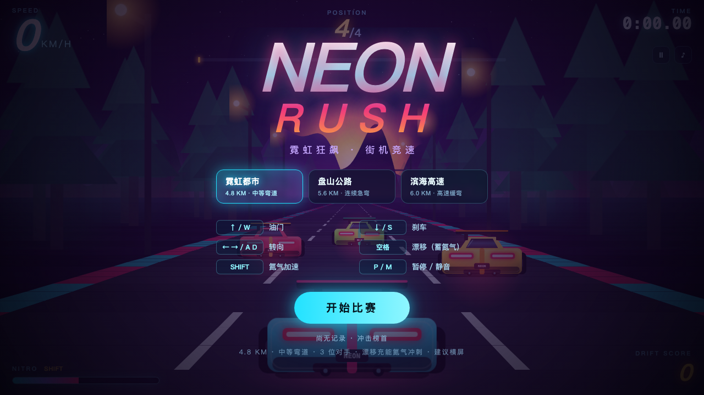
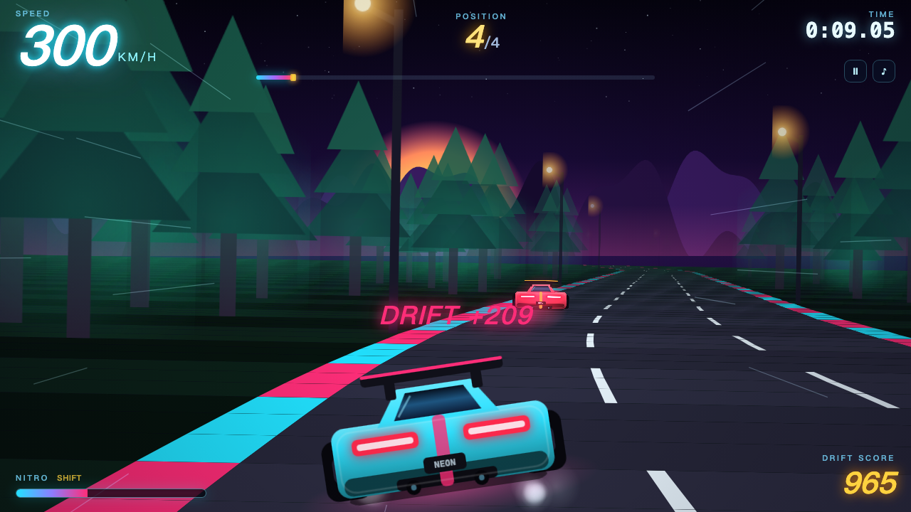
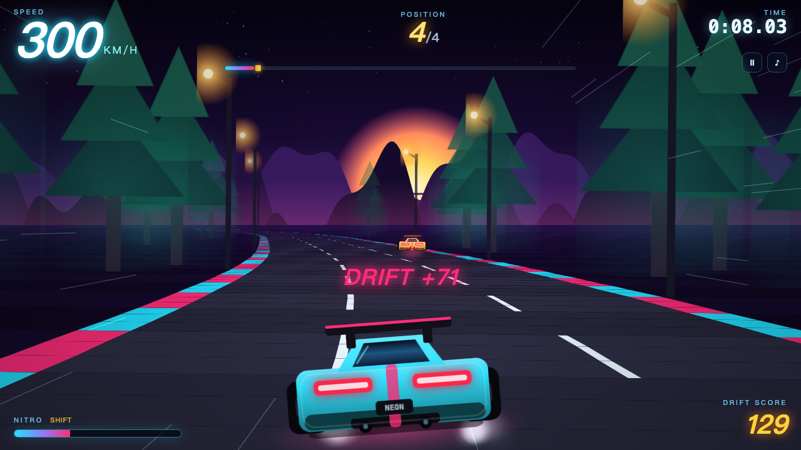
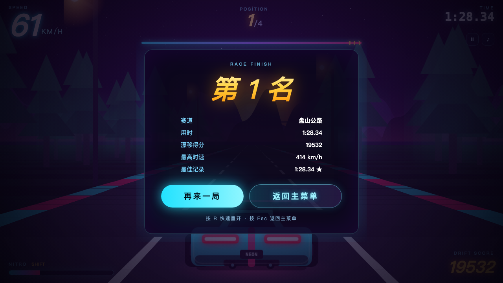
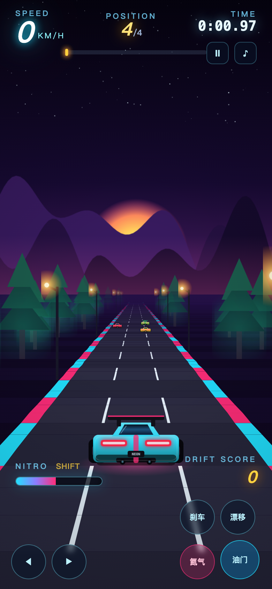
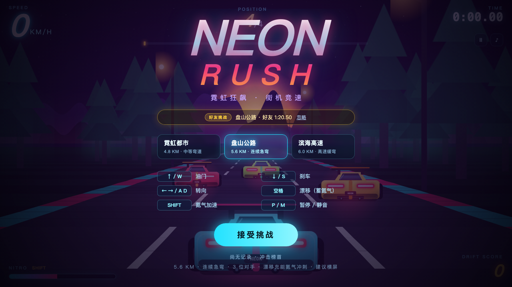
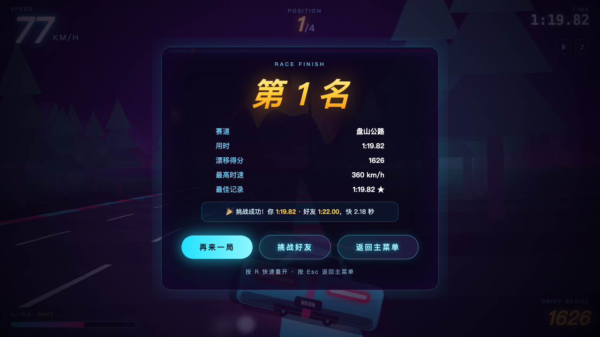

# NEON RUSH · 霓虹狂飙

一个单文件、零依赖的 Web 街机赛车小游戏：伪 3D 赛道 + 漂移蓄氮 + 氮气加速 + AI 对手 + 3 条赛道。

**🎮 在线试玩：https://xuxiaodong915.github.io/neon-rush/**

建议用横屏，手机端会自动出现触屏按键；桌面端用键盘。



## 好友挑战

跑完一局点「挑战好友」→ 复制带赛道种子和用时链接 → 发微信好友；对方打开是同一条赛道，跑完直接判输赢。

## 特性

- 伪 3D 弯道 / 上下坡 / 动态雾效 / 霓虹路肩
- 3 条赛道：霓虹都市（4.8 km）、盘山公路（5.6 km 连续急弯）、滨海高速（6.0 km 长直道）
- 漂移（空格）侧滑并给氮气充能，连击最高 ×5；氮气（Shift）最高 414 km/h
- 3 位 AI 对手：走线摆动、被逼近时让线、按赛道调校强度
- WebAudio 实时合成引擎声 / 漂移声 / 氮气声，无音频文件
- 每条赛道独立最佳记录（localStorage）、返回主菜单、暂停、静音
- 自适应分辨率与 DPR，支持桌面 / 手机横竖屏

| 盘山公路 | 漂移 |
| --- | --- |
|  |  |

| 结算 | 手机 |
| --- | --- |
|  |  |

| 好友挑战 | 挑战结果 |
| --- | --- |
|  |  |

## 全屏 / 去掉浏览器地址栏

- 网页右上角「⛶」按钮：安卓 Chrome、桌面浏览器点一下即全屏（隐藏地址栏）；横屏时会尝试锁定横屏。
- **iPhone Safari 不支持网页全屏**：点右上角「⛶」会提示做法 —— 用 Safari 的「分享 → 添加到主屏幕」，之后从桌面图标打开就是独立窗口（无地址栏），并且已配置横屏启动。
- 已经带了 PWA manifest、图标、`apple-mobile-web-app-capable`，添加到主屏幕后体验接近原生 App。

## 操作

| 按键 | 功能 |
| --- | --- |
| ↑ / W | 油门 |
| ↓ / S | 刹车 |
| ← → / A D | 转向 |
| 空格 | 漂移 / 蓄氮气 |
| Shift | 氮气加速 |
| P | 暂停 / 继续 |
| M | 静音 |
| R | 重新开始 |
| Enter | 开始 / 重开 |
| Esc | 暂停 / 结算界面返回主菜单 |

## 技术

- 单 HTML 文件（约 70 KB），Canvas 2D 手写伪 3D 渲染，无需构建、无外部资源
- 赛道由代码按赛道风格程序化生成（弯道 / 坡度 / 路边物件）
- GitHub Pages 直接托管 `index.html`

## 本地运行

下载 `index.html` 双击即可；或：

```bash
python3 -m http.server 8765
# 打开 http://localhost:8765/index.html
```
